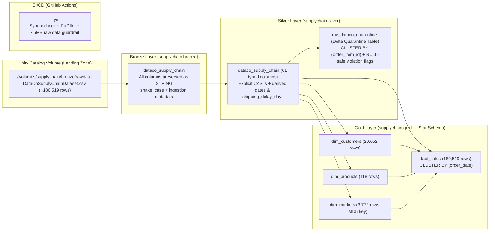

# DataCo Supply Chain — Medallion Lakehouse Architecture

End-to-end **Medallion Architecture** (Bronze → Silver → Gold Star Schema) built on **Databricks**, **Unity Catalog**, **Delta Lake**, and **PySpark** over the **DataCo Smart Supply Chain** dataset (~180,519 order items from 2015 to 2018 covering orders, customers, products, categories, departments, sales, discounts, profit, shipping modes, delivery delays, and geographic markets).

## Architecture Overview



## Repository Structure

```text
supplychain_medallion_architecture/
├── .github/
│   └── workflows/
│       └── ci.yml                            # Syntax check, Ruff fatal lint & raw data size guardrail
├── Notebooks/
│   ├── 01_Bronze_Data_Analysis.py            # Exploratory profiling of raw CSV
│   ├── 02_Bronze_Table.py                    # Raw ingestion & snake_case normalization → Bronze Delta
│   ├── 03_Bronze_Validation.py               # Bronze volume & metadata validation
│   ├── 04_Silver_Espelho.py                  # Explicit typing & derived columns → Silver Delta
│   ├── 04_Silver_Verification.py             # Nulls, masking & key uniqueness profiling
│   ├── 05_Gold_Tables.py                     # Parameterized Gold Star Schema + referential integrity assertions
│   └── 06_Validation_Medallion.py            # Cross-layer Bronze → Silver → Gold reconciliation
├── Pipeline Supply Chain/
│   └── transformations/
│       ├── 01_Pipeline.py                    # Temporary view vw_data_quality_flags
│       ├── 02_Pipeline.py                    # NULL-safe constraint views (validated / violations / summary)
│       └── 03_Pipeline.py                    # Clustered Delta quarantine table (mv_dataco_quarantine)
├── RawData/
│   └── DescriptionDataCoSupplyChain.csv      # Data dictionary (raw CSVs excluded via .gitignore)
├── Schemas.py                                # Unity Catalog schema initialization (bronze, silver, gold)
├── requirements.txt                          # Core Python & lint dependencies
├── .gitignore                                # Excludes large CSV/Parquet files, .env, and caches
└── README.md
```

## Layer-by-Layer Summary

### Bronze (`supplychain.bronze.dataco_supply_chain`)
- Reads `DataCoSupplyChainDataset.csv` from Unity Catalog Volume with `inferSchema=false` (preserving all 53 raw columns as `STRING`).
- Normalizes column names to `snake_case` and appends `_ingestion_timestamp`, `_source_file_name`, and `_source_file_path`.

### Silver (`supplychain.silver`)
- **`dataco_supply_chain` (61 columns):** explicit `CAST` to `INT`, `BIGINT`, `DOUBLE`, `STRING`, and `TIMESTAMP` (`to_timestamp('M/d/yyyy H:mm')`), plus 5 derived fields (`order_date`, `order_time`, `shipping_date`, `shipping_time`, `shipping_delay_days = days_for_shipment_scheduled - days_for_shipping_real`).
- **Data Quality & Quarantine (`01_Pipeline.py` → `03_Pipeline.py`):**
  - Evaluates 50+ non-null rules, 14 numeric range rules, 7 categorical domain rules, and 7 cross-column consistency rules using **NULL-safe logic** (missing values fail non-null constraints without triggering false-positive range/domain violations).
  - Persists rejected rows in **`supplychain.silver.mv_dataco_quarantine`** (Delta table with `CLUSTER BY (order_item_id)`, `_viol_*` boolean flags, `_violations` array, `_violation_count`, and `_quarantine_timestamp`).
  - **Known source anomalies surfaced:** `order_item_profit_ratio` outside `[-1, 1]` (`6,301` rows), `customer_lname` null (`8` rows), and `customer_zipcode` null (`3` rows).

### Gold (`supplychain.gold` — Star Schema)

| Table | Rows | Grain | Key | Notes |
| --- | ---: | --- | --- | --- |
| `dim_customers` | 20,652 | 1 row per `customer_id` | `customer_id` | Excludes sensitive `customer_password` and `customer_street`; adds `first_order_date` and `last_order_date` |
| `dim_products` | 118 | 1 row per `product_card_id` | `product_card_id` | Denormalized with category and department attributes |
| `dim_markets` | 3,772 | Market → Region → Country → State → City | `market_key` (MD5) | Deterministic surrogate key via `md5(concat_ws('\|', ...))` |
| `fact_sales` | 180,519 | 1 row per `order_item_id` | `order_item_id` | Commercial + logistics metrics, `CLUSTER BY (order_date)`, guarded by zero-orphan `assert` checks |

## Prerequisites & Execution Order

1. **Databricks Workspace** with Unity Catalog enabled and catalog `supplychain` created.
2. **Download Dataset:** Download the public **DataCo Smart Supply Chain for Big Data Analysis** dataset (Kaggle) and upload `DataCoSupplyChainDataset.csv` to `/Volumes/supplychain/bronze/rawdata/DataCoSupplyChainDataset.csv` (raw CSVs > 5 MB are intentionally excluded from Git).
3. **Run in order:**
   1. `Schemas.py`
   2. `Notebooks/01_Bronze_Data_Analysis.py` *(optional profiling)*
   3. `Notebooks/02_Bronze_Table.py` → `03_Bronze_Validation.py`
   4. `Notebooks/04_Silver_Espelho.py` → `04_Silver_Verification.py`
   5. `Pipeline Supply Chain/transformations/01_Pipeline.py` → `02_Pipeline.py` → `03_Pipeline.py`
   6. `Notebooks/05_Gold_Tables.py` *(supports Databricks widget params: `catalog`, `silver_schema`, `gold_schema`)*
   7. `Notebooks/06_Validation_Medallion.py`

## Delta Lake FinOps & Maintenance

Run periodically after full reloads to compact small files and reclaim obsolete storage:

```sql
OPTIMIZE supplychain.bronze.dataco_supply_chain;
OPTIMIZE supplychain.silver.dataco_supply_chain;
OPTIMIZE supplychain.silver.mv_dataco_quarantine;
OPTIMIZE supplychain.gold.fact_sales;

VACUUM supplychain.bronze.dataco_supply_chain RETAIN 168 HOURS;
VACUUM supplychain.silver.dataco_supply_chain RETAIN 168 HOURS;
VACUUM supplychain.gold.fact_sales RETAIN 168 HOURS;
```

## CI/CD

The workflow [.github/workflows/ci.yml](.github/workflows/ci.yml) runs on every Pull Request to `main` and via `workflow_dispatch`:
- Python syntax compilation (`py_compile`) across all notebooks and transformation scripts;
- Fatal AST/syntax linting via `ruff`;
- Repository hygiene guardrail blocking accidental commits of raw data files (`*.csv`, `*.parquet`, `*.zip`, `*.db`) larger than 5 MB.
